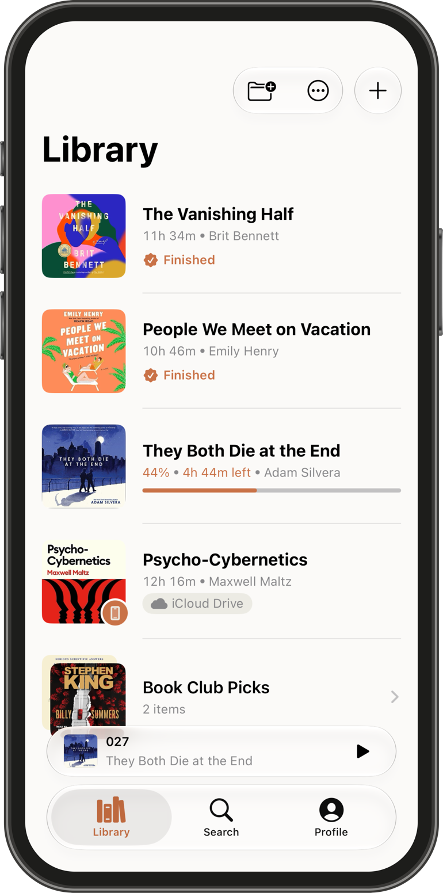
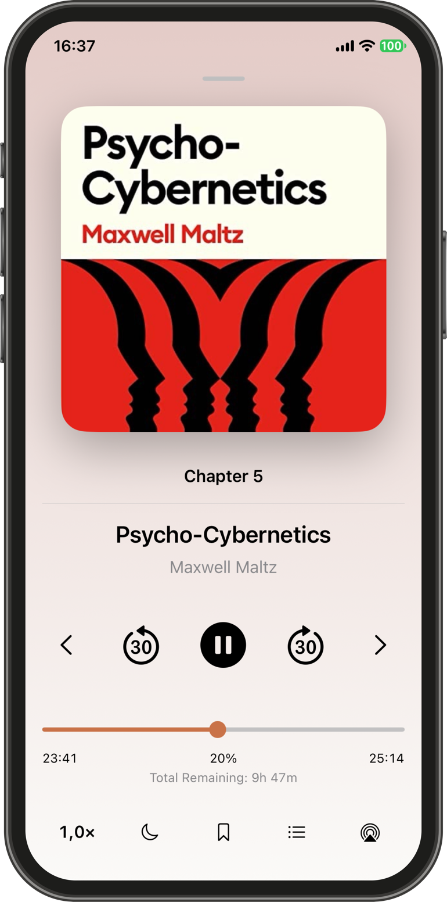
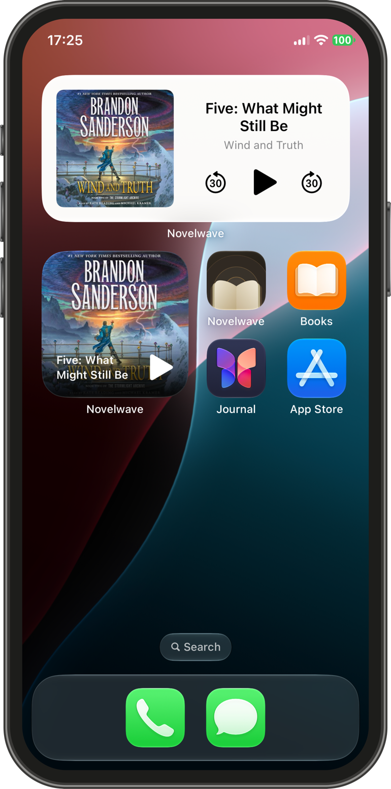

# Novelwave: An Audiobook Player

This repository is used to host the promotional website for Novelwave, an iOS 
player designed for your personal DRM-free audiobook collection. Effortlessly import, organize, and customize your audiobooks for a truly personalized listening journey.

<table>
  <tr>
    <td valign="top"></td>
    <td valign="top"></td>
    <td valign="top"></td>
  </tr>
</table>

The website is available at [novelwave.app](https://www.novelwave.app).

## 🚀 Features

- **Flexible Imports:**  
Support a variety of audio formats to bring all your audiobooks into one place.

- **Easy Organization:**  
Create collections, merge multiple audio files into a single audiobook, and edit titles, authors and artwork.

- **Advanced Playback Options:**  
Adjust playback speed, skip forward/backward or to a specific timestamp and schedule sleep timers.

- **Intuitive Chapter Navigation:**  
Quickly jump between chapters (if available) for a smoother experience.

- **Smart AirPods Integration:**  
Tap once to play/pause your audiobook, twice to skip forward and tap three times to skip backward.

- **Bookmarks & Notes:**  
Save and annotate important moments for easy reference.

- **AirPlay Support:**  
Stream your audiobooks to other devices seamlessly.